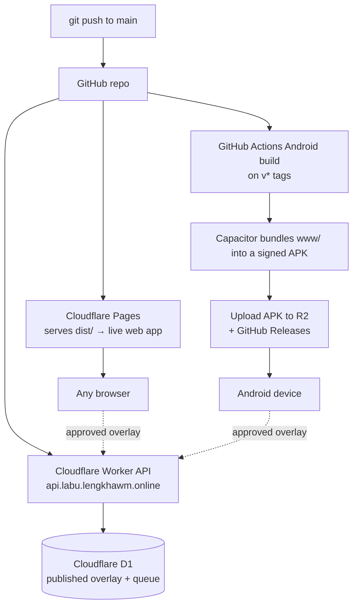
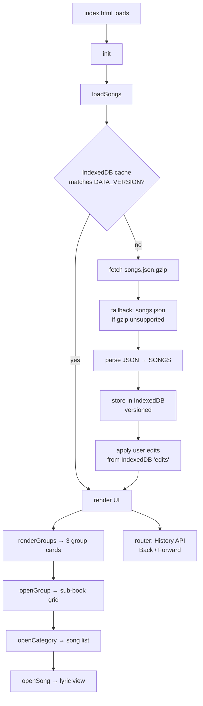
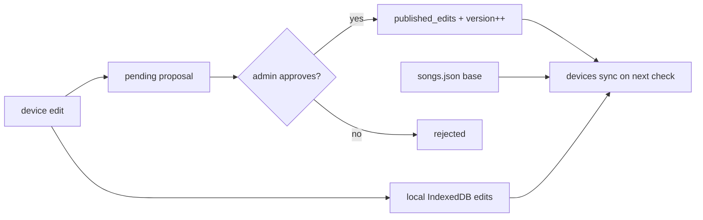
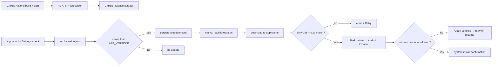

# Khristian Labu — How It Works

## Deployment pipeline

## Runtime (web & APK share the same index.html)

## Features (all client-side)

| Area | Where | Notes |
|------|-------|-------|
| Favourites / History | `localStorage` | per-device |
| Playlists (multiple) | `localStorage` | named lists |
| Search | in-memory filter | live as you type |
| Settings | `localStorage` | theme, wake-lock, reset |
| Manage Songs (admin) | IndexedDB `edits` + Worker | edit/add/export; proposals and approvals sync through D1 |

## Key design points

- **One codebase, two targets** — `www/` (index.html + songs.json + logo + assets) is served to the web *and* bundled into the Android APK via Capacitor. No separate mobile code.
- **Data loads at runtime** (`fetch`), not embedded — a `songs.json` change ships without touching app code. `DATA_VERSION` bumps invalidate the IndexedDB cache.
- **Offline edits** — user song edits are stored separately in IndexedDB (`edits`) and replayed over the base corpus on every load, so they survive `songs.json` updates.
- **Approved-change sync (Cloudflare Worker + D1)** — submitted edits become pending proposals; an admin approval appends to `published_edits` and bumps `publish_state.version`. Devices replay base corpus → approved overlay → own edits, so an approval reaches web and APK installs without a rebuild. See `workers/api/README.md`. The Supabase client path is legacy and only remains for old APKs.
- **Gzip speedup** — web/APK fetch `songs.json.gzip` (630KB) via `DecompressionStream`, falling back to plain `songs.json` (2.2MB).
- **Hybrid app** — the APK is a native Android shell running the web assets in a Chromium WebView: installs like a real app, works offline, but the UI is web tech (not Kotlin/native UI).
- **Centered, responsive UI** — homepage group cards centered on desktop/tablet; menu popup is a centered modal (two-column landscape layout on desktop, single column on mobile).
- **Status bar (APK)** — the `@capacitor/status-bar` plugin keeps the app below the Android status bar (`setOverlaysWebView(false)`), colors it to match the theme, and picks light/dark icons. On Android 15+ (forced edge-to-edge) the nav is padded below the bar via a three-layer fallback: `max(env(safe-area-inset-top), var(--safe-area-inset-top), var(--sat-fallback))` — the last being the plugin's native `getInfo().height`, applied only when the WebView reports no inset at all.
- **List DOM persistence** — song-list rows are cached per list (keyed by category/fav/recent/playlist id) as both HTML and live detached nodes. Back/forward nav returns to a list whose rows are already rendered and just re-shows the view (or re-attaches cached nodes) — zero DOM rebuild, no re-fade. Edits and fav-toggles invalidate the caches so lists re-render fresh when data actually changed.
- **Reader footer** — the font/line-spacing controls AND the song actions (edit / playlist / favorite / share, moved here from above the title) live in a dedicated footer element. `#detailView` is a flex column: the lyrics scroll inside `#songScroll` (a `flex:0 1 auto; overflow-y:auto` container), and `#readerControlsHost` is a separate in-flow sibling **below** it. Because the scroll container clips at the footer's top edge, lyrics can physically never render, scroll, or disappear behind the footer — at any scroll position, with any footer height (system font scaling, safe-area insets), on any device. Long songs fill the space above the footer and scroll; short songs end naturally right above it (no dead zone) with the container scroll-locked until the font size or line spacing grows past the fold. Bottom safe-area (`--sab`) is synced from Capacitor's `--safe-area-inset-bottom`, and the footer's real height (`--footer-h`) keeps the WhatsApp share FAB/menu floating above it.

## Approved-change sync (Cloudflare Worker + D1)

Editing stays offline-first: a change applies on the device immediately and is
queued as a proposal. The admin reviews the queue in Manage Songs and approves;
approval writes the change into `published_edits` and increments
`publish_state.version` in one transaction. Every device compares that version on
launch, on focus, on `online`, and every 5 minutes, then rebuilds the corpus in
place from the IndexedDB base copy.

Only the diff layer lives in Cloudflare D1, so the corpus is never re-uploaded and
`DATA_VERSION` does not change when something is approved. The client config is the
public `LABU_CLOUD_API` Worker origin; with it blank the app is purely local. Admin
sessions use Better Auth bearer tokens on the APK and session cookies on the web.

## App updates (free, self-hosted distribution)

The website is served by **Cloudflare Pages** and deployed from the staged `dist/` build by `.github/workflows/pages.yml` on every push to `main`. The approved-change API runs on a **Cloudflare Worker + D1** at `api.labu.lengkhawm.online`. The APK is built and signed by `.github/workflows/android-release.yml`, stored in **Cloudflare R2** at `dl.labu.lengkhawm.online`, and also attached to a **GitHub Release** as fallback. No Play Store and no paid cloud.

- **Web users**: the Cloudflare Pages deployment updates from GitHub Actions on every push to `main` (no action needed).
- **APK users**: `fetchUpdateInfo()` compares the newest release against the embedded `APP_VERSION`. It reads **both** the static `version.json` and R2 `latest.json` and takes the higher version, so a fresh R2 publication cannot be reported as “already current” while Pages/raw GitHub catch up. The check runs after the boot cover clears and on demand from Settings → **Check for update**. The website hides the manual row and skips the startup check because Pages always serves the current build.
- **Native update path (1.5.64+, current)**: a newer build opens a centered progress dialog and starts the download immediately; tapping outside minimizes it to a floating progress pill while the transfer continues. `latest.json` supplies the APK URL, byte size, and SHA-256, then the `KhristianUpdate` bridge calls `UpdateInstaller.java`. The downloader writes app-private cache, keeps a `.part` file plus a URL/hash/size sidecar, and resumes an interrupted transfer with an HTTP `Range` request. It verifies the full-file SHA-256 and size before launching Android's installer through `FileProvider`; Android still shows its own confirmation. If `canRequestPackageInstalls()` is false, the app opens the per-app unknown-sources page and retries on `onResume`. Failures stay in the same dialog with Retry, and the partial file is retained. Browser fallback remains for old APKs.
- **Free tier**: GitHub Releases + API are free; the unauthenticated API limit (60 req/hr per IP) is ample for occasional client checks.

## PWA / offline support

The website is installable and works offline (no backend, all static on Pages).

- **`manifest.webmanifest`** — name, icons (192/512 from `assets/logo.svg`), `display: standalone`, `theme-color`. Enables "Add to Home Screen".
- **`sw.js`** — a service worker caching strategy:
  - App **shell** (index.html, logo, manifest, icons): precached on install; **network-first** with cache fallback, so the UI is always fresh when online and still loads offline.
  - **Song data** (`songs.json` / `songs.json.gzip`): **cache-first** with background refresh → instant repeat loads and full offline access after the first visit.
  - Cache name is `labu-vN` tied to `DATA_VERSION`; bump both together so data updates propagate.
  - Only registers on the **web** (`!window.Capacitor`); the native APK already ships assets offline, so the SW is skipped there.
- **Meta**: `theme-color`, `apple-mobile-web-app-*` tags added to `<head>`.

