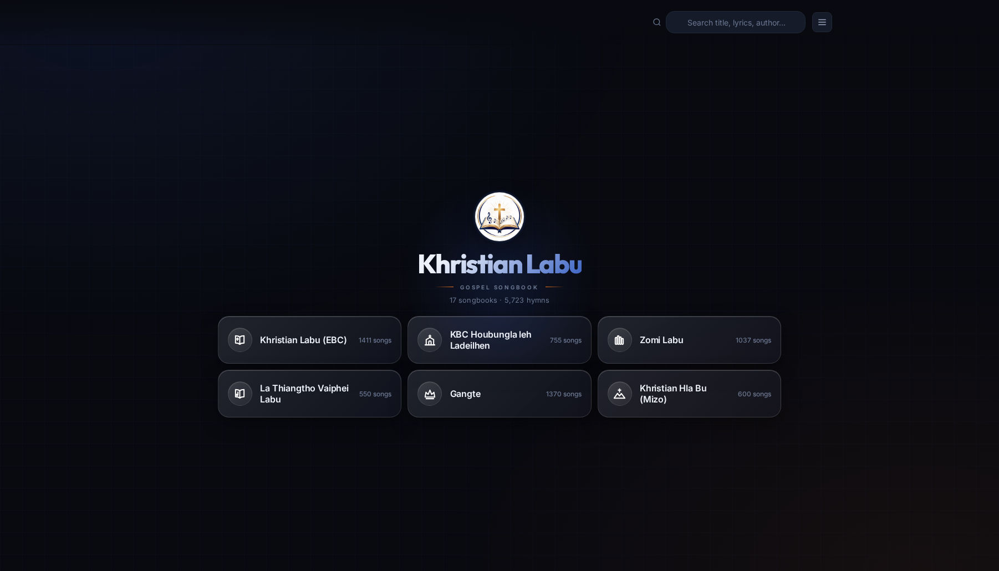

# Khristian Labu

A gospel songbook app — 5,719 hymns across 17 songbooks in 6 collections.

Try it live: [minatolun-dotcom.github.io/khristian-labu](https://minatolun-dotcom.github.io/khristian-labu/)

## Screenshots

**Desktop**


**Mobile**


## Features

- **17 songbooks across 6 collections** (Kuki, Zomi, Mizo): Khristian Labu (EBC), KBC, Zomi Labu, Tedim, La Thiangtho Vaiphei, Gangte, Mizo Khristian Labu, and more
- **Full-text search** — titles, authors, verses, and numbers, with filters, sorts, and recent-search history; search scopes to the open songbook, collection, playlist, favorites, or history list
- **Favorites & recently viewed** (saved locally)
- **Playlists** — create, rename, delete; export as JSON or plain text
- **Reader** — adjustable font size & line spacing, per-song scroll memory, verse jump, swipe between songs
- **WhatsApp share** — share any lyric as text or as a full-song screenshot (even if it scrolls)
- **Google Drive backup & restore** (optional sign-in) plus local backup/restore of settings, favorites, recents, playlists, and edits
- **Works offline** — full corpus cached via service worker + IndexedDB
- **Update checks** — the app checks for a newer release on start-up and from Settings, then links to the GitHub Releases page
- Dark/light theme, admin panel for adding/editing/deleting songs, find & replace across all songs

## Download

Grab the latest APK from the [Releases](https://github.com/minatolun-dotcom/khristian-labu/releases) page.
When a new version is out, the app shows a banner (and Settings → Check for update) that takes you
to the release page to download and install it manually.

## Development

All app source lives in a single file — `index.html` (plus `sw.js` for offline caching). No web build step.

```bash
# serve locally (no-store headers + network-only service worker, so edits show up)
python3 scripts/serve_dev.py 8080
# open http://localhost:8080
```

### Releasing a new version

APKs are compiled locally — no GitHub Actions workflow builds or publishes them. A push to `main` only updates the web app (GitHub Pages).

```bash
# 1. bump the version (keep these in sync)
#    - const APP_VERSION in index.html
#    - version.json
#    - CACHE in sw.js

# 2. build locally and copy the APK
npm run sync
cd android && ./gradlew assembleDebug --no-daemon && cd ..
cp android/app/build/outputs/apk/debug/app-debug.apk apk/KhristianLabu-debug.apk

# 3. commit, tag, and push
git add index.html sw.js version.json # plus any other changed app files
git commit -m "chore: release v1.5.34"
git tag v1.5.34
git push origin main --tags

# 4. publish the release with the local APK
gh release create v1.5.34 apk/KhristianLabu-debug.apk#khristian-labu.apk --title v1.5.34 --latest
```

The release asset is the locally compiled `khristian-labu.apk`; installed apps read `version.json` to point users at the latest release.

### Tests

```bash
npm test            # data/corpus validation + full browser E2E suite (68+ checks)
```

- `scripts/validate_data.py` — corpus integrity (IDs, verses, groups↔counts, gzip match, no HTML in lyrics)
- `scripts/e2e_full.mjs` — drives the real UI in headless Chromium (needs `npx playwright install chromium` once)

## License

MIT
