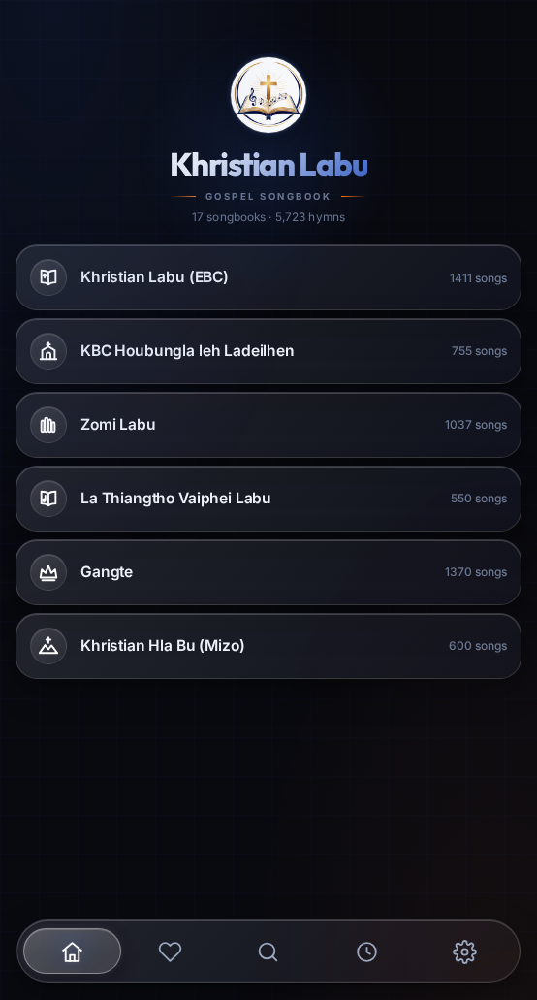

# Khristian Labu

A gospel songbook app — 5,723 hymns across 17 songbooks in 6 collections.

[Try it live](https://labu.lengkhawm.online/) · [Download the APK](https://github.com/minatolun-dotcom/khristian-labu/releases)

## Screenshots

**Web**


**Android**



## Features

- 17 songbooks across 6 Kuki, Zomi, and Mizo collections
- Full-text search of titles, lyrics, authors, and numbers across every songbook, with filters, sorting, and recent searches
- Choose which main songbooks appear on Home and in search; turn off collections you don't use
- Favorites and recently viewed songs, saved on device
- Playlists with rename, delete, and JSON or text export
- Reader with font size, line spacing, scroll memory, verse jump, and swipe navigation
- WhatsApp sharing as text or a full-song image
- Google Drive backup and restore, plus local backup
- Offline access to the entire songbook
- Dark and light themes, plus an admin editor with find and replace

## Install

Download the latest APK from [Releases](https://github.com/minatolun-dotcom/khristian-labu/releases)
([R2 release metadata](https://dl.labu.lengkhawm.online/latest.json)). The app checks `version.json` on
launch and from Settings → Check for update. In the Android app, **Update now** downloads the signed
APK in-app, verifies its published SHA-256, then opens Android's installer. If Android blocks installs
from the app, the card offers **Open settings**. Browser visitors still get the direct APK asset.

If Android reports a signature mismatch when installing a signed release over an older build,
export a local backup first, then uninstall the old app and install the release. That is a one-time
migration from the debug-signed builds; later signed releases install over each other normally.

## Development

The app is `index.html` and `sw.js` — there is no web build step. The approved-change
API lives in `workers/api` on Cloudflare Worker + D1 (see `workers/api/README.md`).

```bash
python3 scripts/serve_dev.py 8080   # http://localhost:8080
```

Build the Android APK:

```bash
npm run sync
cd android && ./gradlew assembleDebug --no-daemon
# android/app/build/outputs/apk/debug/app-debug.apk
```

The Android native project is tracked. Generated build outputs and copied web assets are ignored.
The padded launch-screen icons remain in `resources/android-splash/` and are installed by `npm run sync`.

Release builds are produced by `.github/workflows/android-release.yml` on a `v*` tag or manual dispatch. The workflow signs with the repository's `KEYSTORE_*` secrets, publishes the APK to `https://dl.labu.lengkhawm.online/apk/<versionCode>/khristian-labu.apk`, and creates the GitHub Release fallback.

To release, bump `APP_VERSION` in `index.html`, `version.json`, `CACHE` in `sw.js`, and `versionCode`/`versionName` in `android/app/build.gradle`, then:

```bash
git tag vX.Y.Z && git push origin main --tags
```

## Tests

```bash
npm test        # corpus validation + full browser E2E
npm run test:cloud   # approved-change client against a mocked Worker
npm run test:api     # 25-check contract suite (local or LABU_API_URL)
```

## License

MIT
